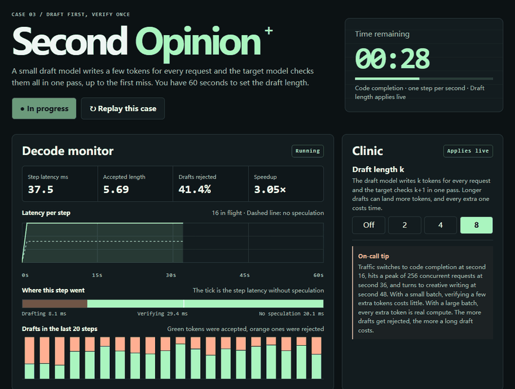

# Inference ER

English · [简体中文](README.zh-CN.md)

You're on call for an LLM serving stack. In three 60-second browser games, decide which requests to prioritize, where to place MoE experts, and how far a draft model should speculate.

**[Play online](https://shaqg.github.io/inference-er/)** · [Jump to speculative decoding](https://shaqg.github.io/inference-er/spec/)

[](https://shaqg.github.io/inference-er/spec/)

In the demo, the same draft length goes from helping code completion to slowing down decode at **256 concurrent requests**. The game switches traffic mid-run so you can change your policy and see the result. All workloads and metrics are simulated.

## Pick a case

| Case | Your decision | Play |
| --- | --- | --- |
| **01 · Scheduling** | Long prompts are piling up. Can you protect short chats while keeping enough capacity for long requests? | [Play case 01](https://shaqg.github.io/inference-er/) |
| **02 · MoE Triage** | A few experts are slowing down all ranks. When should you move weights, and when should you add a replica? | [Play case 02](https://shaqg.github.io/inference-er/triage/) |
| **03 · Second Opinion** | Drafting can produce more tokens per target pass. When does the cost of verification make a shorter draft worthwhile? | [Play case 03](https://shaqg.github.io/inference-er/spec/) |

Each case replays the same workload and compares your run against a default policy. To play offline, download the repository and open [Scheduling](index.html), [MoE Triage](triage/index.html), or [Second Opinion](spec/index.html) in a browser. No installation or account is required.

## CASE 01 · Scheduling

1. Click **Take over**. The first long prompt arrives at second 8.
2. Change the decode batch size, prioritize short requests, or limit long requests. Watch backlog, short-request TTFT P95, and output tokens per second.
3. Compare the debrief with the default policy. Replay the same case and change one setting at a time.

### Request replay format

Use **Import request JSON** to load a local [example](examples/request-replay.json) or your own workload. Importing starts a fresh round and recomputes the default policy on the imported requests. Files are read locally in the browser.

```json
{
  "version": 1,
  "source": "synthetic",
  "requests": [
    {"at": 1, "kind": "short", "prefillWork": 4, "outputTokens": 5, "timeout": 9},
    {"at": 8, "kind": "long", "prefillWork": 34, "outputTokens": 25, "timeout": 23}
  ]
}
```

| Field | Meaning |
| --- | --- |
| `source` | Use `synthetic` for hand-built workloads or `trace-derived` for workloads derived from an experiment. |
| `at` | Arrival second, an integer from 1 to 60. Sort rows by arrival. Rows in the same second retain file order. |
| `kind` | `short` or `long`. Used for scheduling and metric grouping. |
| `prefillWork` | Prefill work in simulated budget units. |
| `outputTokens` | Target output token count. Both work values are integers from 1 to 10,000. |
| `timeout` | Simulated deadline in seconds after arrival, from 1 to 60. A request expires on the first tick after its deadline. |

Keep each file under 128 KiB with 1 to 600 requests. To prepare a replay from a real trace, round arrivals into seconds, choose a documented mapping from prompt length to prefill work, and leave out prompt text and request identifiers. A replay models the arrivals only. All game metrics are simulated.

### How the simulation works

Prefill and decode draw from a simple shared budget. Decode is capped by the selected batch size. The default uses batch size 4 with prioritization and admission limits off. The debrief counts timeouts, rejections, and requests still in flight separately. TTFT is time to first token. Its P95 includes requests that produced a first token, even if they timed out later.

## CASE 02 · MoE Triage

1. Click **Start triage**. Two experts heat up at second 15, and one dominant expert takes over at second 39.
2. Click **Rebalance now**, and turn on **Redundant experts** when moving experts is not enough. Watch step latency, the imbalance, the idle share, and the load on each rank.
3. Compare the debrief with the default policy. Replay the same tokens and change one setting at a time.

### How the simulation works

Each second is one step of 4096 tokens through a model with 16 experts and top-2 routing across 4 ranks. A seeded generator draws the routing, so every replay sees the same tokens, and no token is dropped. A rank computes every row routed to its experts, a step finishes when its slowest rank does, and the idle share is the rank time the other ranks spend waiting. Rebalancing re-places experts by their load over the last 4 steps. Weights only move when the new layout cuts the slowest rank's load by 5% or more, and every new copy or swapped pair adds weight moves to that step. Redundant experts give each rank a fifth slot for 25% more weight memory and split a hot expert's tokens evenly across its copies. The default policy never rebalances and uses no redundant experts.

The cost model is sized from a reference deployment, not measured: 58 MoE layers with experts of hidden size 7168 and intermediate size 2048 in BF16, about 150 TFLOPS of effective compute, and a 150 GB/s link. That gives about 34 µs per row per step, 1.2 ms of fixed overhead per step, and 34 ms to move one expert's weights. Communication is assumed to overlap with compute. A production rebalance moves weights for every layer and runs minutes apart; the game compresses that into a pause of a few steps.

## CASE 03 · Second Opinion

1. Click **Start rounds**. Traffic moves from chat to code completion at second 16, a peak of 256 concurrent requests takes over at second 36, and creative writing starts at second 48.
2. Pick the draft length: off, 2, 4, or 8. Watch step latency, the accepted length, the share of drafted tokens rejected, and the speedup over the same step without speculation.
3. Compare the debrief with the default policy, phase by phase. Replay the same matches and change one setting at a time.

### How the simulation works

Each second is one decode step. For every request in the batch a 1B draft model writes k tokens, one step at a time, and the target model checks all of them in a single forward pass. A request keeps the drafted tokens up to its first mismatch and gets one token of the target's own, so it emits between 1 and k+1 tokens per step. Whether a drafted token matches is drawn by a seeded generator: 75% in chat, 92% in code completion, 75% at peak and 45% in creative writing. The batch is 16 requests, except for 256 at peak, so chat and peak differ only in batch size. Every replay reuses the same draws, so policies are compared on the same matches. The default keeps speculation off. Speedup compares a step's output per request with the same step without speculation. Speedup and accepted length are averaged over requests, so each step counts by its batch size and the peak weighs more than the quiet hours.

The cost model is sized from a reference deployment, not measured: a 70B dense target and a 1B draft, both in BF16, on 8 A100 80GB with tensor parallel 8. Every forward pass takes the larger of its weight-read time and its compute time, with a smooth knee between the two. Reading the target's weights, about 140 GB, takes about 20 ms, which is about 43% of the aggregate HBM bandwidth once all-reduce and launch overhead are counted. Each token the target verifies adds about 0.15 ms of compute, which is 140 GFLOPs at about 0.9 PFLOPS effective, so a target step is bound by weight reads below about 130 tokens and by compute above that. A draft step is a fixed 1 ms, dominated by kernel launches and synchronization rather than its 2.5 GB of weights, plus 0.01 ms per drafted token.

Token matches are independent and identical for every request, while real acceptance is bursty and varies by request and by position. Only chain drafts are modeled, not tree drafts such as EAGLE or Medusa. Attention, prefill and the draft model's memory are left out.

Run the workload and simulation checks for all three cases locally with `node --test`.
