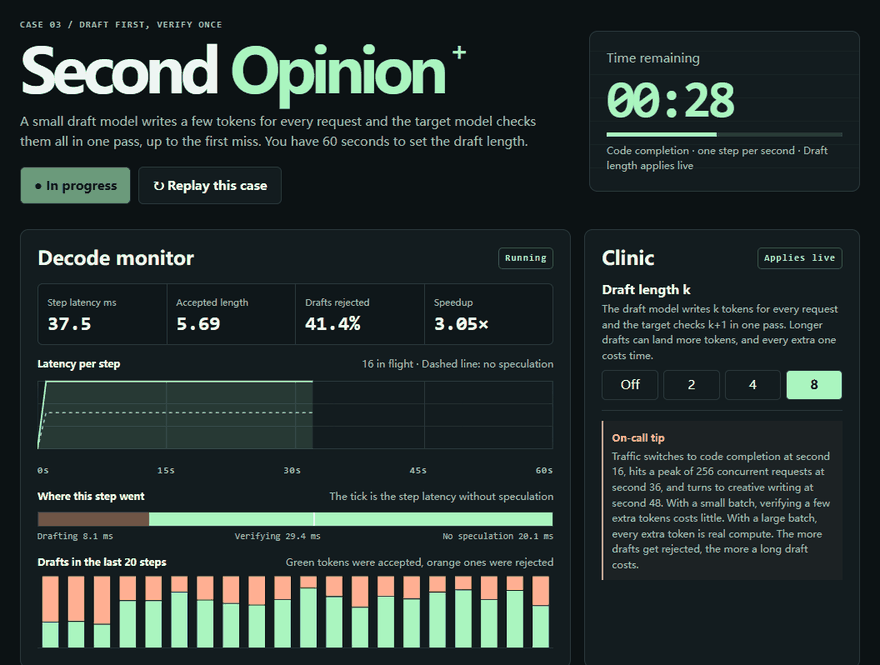
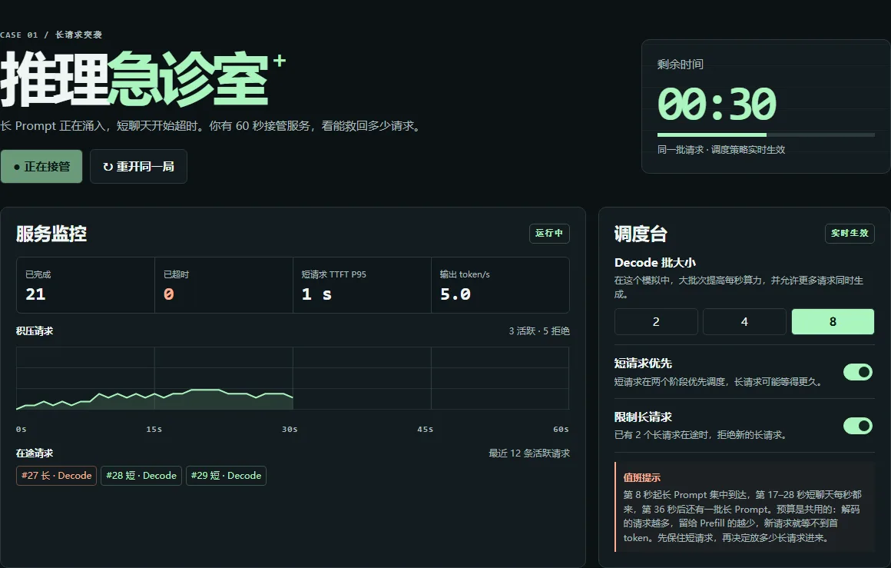
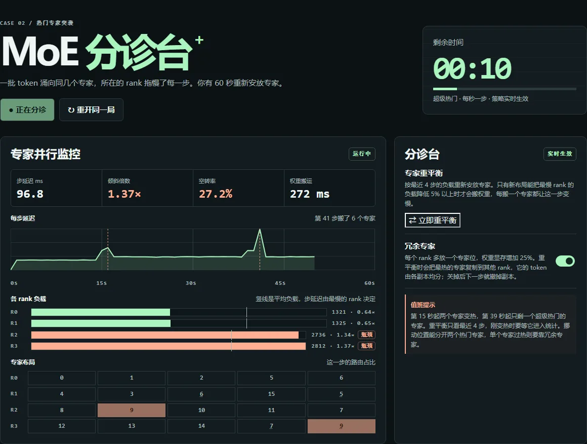
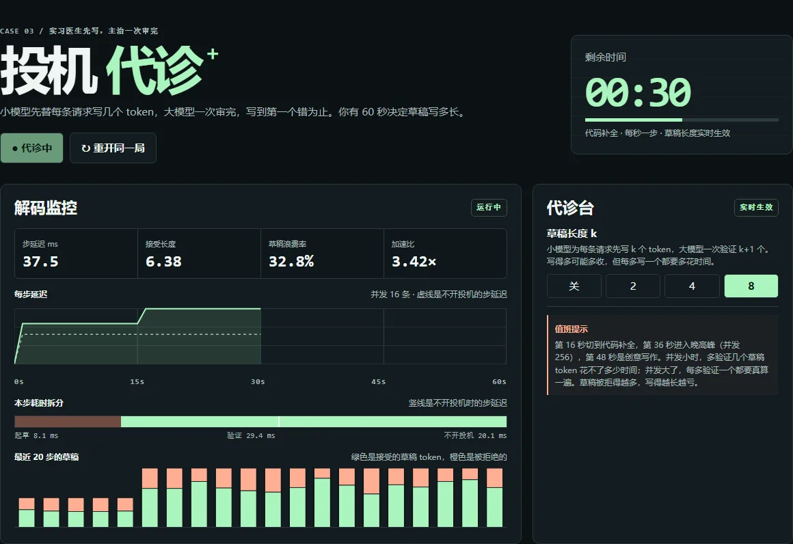
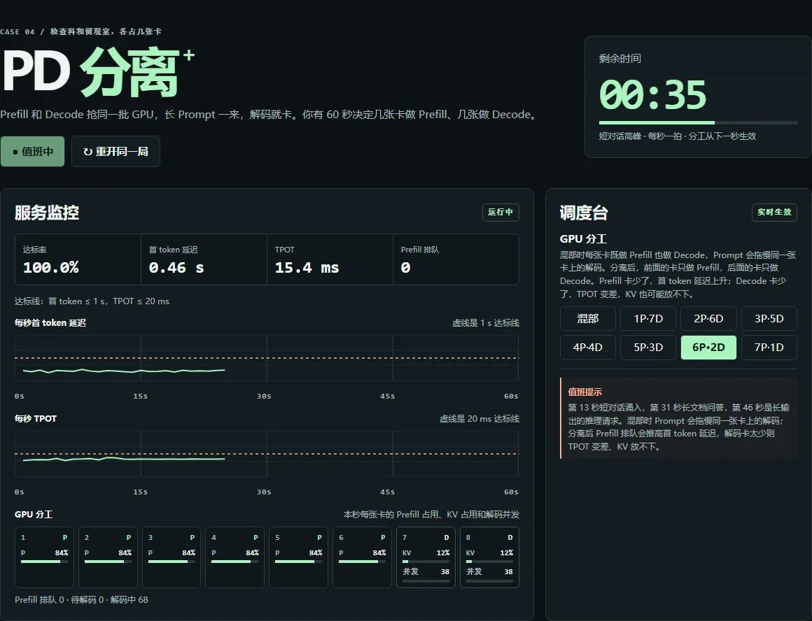

# 推理急诊室

[English](README.md) · 简体中文

你是 LLM 推理服务的值班工程师。四关，每关 60 秒。挑选先处理的请求，给 MoE 专家换位置，决定 draft model 每轮写几个 token，再定几张卡做 Prefill、几张卡做 Decode。

**[在线试玩](https://shaqg.github.io/inference-er/)** · [选择关卡](#选择关卡)

[](https://shaqg.github.io/inference-er/spec/)

演示的是第三关（共四关）：同样起草 8 个 token，代码补全时能加速，到了 **256 并发**的高峰却成了负担。每一关都会在途中切换流量，你可以随时调整策略，观察延迟和吞吐的变化。关卡负载和结果均为模拟值。

## 选择关卡

| 关卡 | 你要做的决定 | 试玩 |
| --- | --- | --- |
| **01 · 调度** | 长 Prompt 突然涌入，怎么保住短聊天的响应时间，又给长请求留出算力？ | [试玩第一关](https://shaqg.github.io/inference-er/) |
| **02 · MoE 分诊台** | 热门专家拖慢了整个 batch，什么时候该搬权重，什么时候该加副本？ | [试玩第二关](https://shaqg.github.io/inference-er/triage/) |
| **03 · 投机代诊** | 一次 target 前向可以多生成几个 token。验证成本高到什么时候值得缩短草稿？ | [试玩第三关](https://shaqg.github.io/inference-er/spec/) |
| **04 · PD 分离** | Prefill 和 Decode 抢同一批 GPU，每个 Prompt 都会拖慢所在卡的解码。几张卡只做 Prefill，几张只做 Decode？ | [试玩第四关](https://shaqg.github.io/inference-er/pd/) |

[](https://shaqg.github.io/inference-er/?lang=zh)
[](https://shaqg.github.io/inference-er/triage/?lang=zh)
[](https://shaqg.github.io/inference-er/spec/?lang=zh)
[](https://shaqg.github.io/inference-er/pd/?lang=zh)

每次重开都会回放同一批负载，复盘可以和默认策略比较。也可下载仓库，在浏览器离线打开[调度](index.html)、[MoE 分诊台](triage/index.html)、[投机代诊](spec/index.html)或[PD 分离](pd/index.html)，无需安装或登录。

## CASE 01 · 调度

1. 点击 **接管服务**。第 8 秒会出现第一条长请求。
2. 调整 Decode 批大小、短请求优先或长请求限流。观察积压、短请求 TTFT P95 和输出吞吐。
3. 查看复盘，与默认策略对比。重开同一局，每次改动一项设置。

### 请求回放格式

点击 **导入请求 JSON**，载入本地[示例](examples/request-replay.json)或自己的请求文件。导入后会开始新一轮，并在同一批请求上重新计算默认策略。浏览器在本地读取文件。

```json
{
  "version": 1,
  "source": "synthetic",
  "requests": [
    {"at": 1, "kind": "short", "prefillWork": 4, "outputTokens": 5, "timeout": 9},
    {"at": 8, "kind": "long", "prefillWork": 34, "outputTokens": 25, "timeout": 23}
  ]
}
```

| 字段 | 含义 |
| --- | --- |
| `source` | 合成请求填 `synthetic`，根据实验轨迹生成的请求填 `trace-derived`。 |
| `at` | 到达时间，取 1 到 60 的整数秒。按到达时间排序，同秒请求按文件顺序处理。 |
| `kind` | `short` 或 `long`，用于调度和指标分组。 |
| `prefillWork` | Prefill 工作量，用模拟预算单位计。 |
| `outputTokens` | 目标输出 token 数。工作量和输出 token 数均取 1 到 10,000 的整数。 |
| `timeout` | 自到达起的模拟超时秒数，取 1 到 60。超过截止时间后的第一个模拟步判定为超时。 |

文件大小上限为 128 KiB，每轮可包含 1 到 600 条请求。从实测生成回放时，将到达时间归入整数秒，记录从输入长度到 Prefill 工作量的换算规则，并去掉 Prompt 正文和原始请求 ID。请求时间可以来自实测，游戏结果仍是模拟值。

### 模拟规则

Prefill 和 Decode 共用简化的算力预算，Decode 每步受批大小限制。默认策略使用批大小 4，关闭优先和限流。超时、主动拒绝和结束时仍在途的请求分别计数。TTFT 是首 token 等待时间，P95 统计已输出首 token 的请求，包括后来超时的请求。

- **负载**：每隔一秒一条短聊天，长 Prompt 分三波从第 8、13、36 秒涌入。短聊天要在 9 秒内产出 5 个 token，长 Prompt 是 23 秒内 25 个。
- **规则**：每秒有 10–18 个单位的共享预算（随批大小）。解码每条请求最多产出两个 token，Prefill 用剩下的预算，打开优先时按短请求优先排。
- **未建模**：一秒内每个 token 的耗时、KV cache 和 continuous batching。

## CASE 02 · MoE 分诊台

1. 点击 **开始分诊**。第 15 秒起两个专家变热，第 39 秒起只剩一个超级热门的专家。
2. 点击 **立即重平衡**；挪动位置不够时，打开 **冗余专家**。观察步延迟、倾斜倍数、空转率和每个 rank 的负载。
3. 查看复盘，与默认策略对比。重开同一批 token，每次改动一项设置。

### 模拟规则

每一秒是一步，4096 个 token 经过一个 16 专家、top-2 路由的模型，专家分布在 4 个 rank 上。路由由固定随机种子生成，每次重开看到的 token 完全相同，也不会丢弃任何 token。

- **规则**：rank 要算完路由到它那些专家的所有行，一步要等最慢的 rank 结束，空转率是其余 rank 等待它的时间占比。重平衡按最近 4 步的负载重新安放专家：只有新布局能把最慢 rank 的负载降低 5% 以上时才会搬权重，每新增一个副本或交换一对专家，这一步都要多搬一次权重。
- **冗余专家**：每个 rank 多放一个专家位，权重显存增加 25%，热门专家的 token 由各副本均分。副本只会放到还没有这个专家的 rank 上。关掉冗余专家会在下一步撤掉副本，不搬权重；增加副本则需要重平衡。默认策略不做重平衡，也不用冗余专家。
- **未建模**：丢 token 和分发延迟。每个 token 都会到达恰好两个专家。

成本模型按一个参考配置估算，不是实测值：58 层 MoE，专家的 hidden 为 7168、中间维度为 2048，BF16，有效算力约 150 TFLOPS，rank 之间链路 150 GB/s。由此得到每步每行约 34 µs、每步固定开销 1.2 ms、每搬一个专家的权重 34 ms，并假设通信与计算重叠。真实系统里重平衡要搬所有层的权重，间隔以分钟计，游戏把它压缩成了几步的停顿。

## CASE 03 · 投机代诊

1. 点击 **开始代诊**。第 16 秒切到代码补全，第 36 秒进入 256 条并发的晚高峰，第 48 秒开始是创意写作。
2. 选择草稿长度：关、2、4 或 8。观察步延迟、接受长度、草稿浪费率，以及相对不开投机的加速比。
3. 查看复盘，按阶段与默认策略对比。重开同一批草稿，每次改动一项设置。

### 模拟规则

每一秒是一步解码。草稿模型为并发批次里的每条请求写 k 个 token，一次写一个；目标模型用一次前向把它们全部验证。每条请求保留第一个不匹配之前的草稿 token，再得到一个目标模型自己生成的 token，所以每步产出 1 到 k+1 个 token。每次重开用的是同一批随机结果，所以不同策略是在同样的匹配上比较。默认策略关闭投机解码。

- **负载**：并发批次是 16 条，晚高峰是 256 条，所以日常对话和晚高峰只差在批次大小上。草稿 token 是否匹配由固定随机种子生成：日常对话 75%，代码补全 92%，晚高峰 75%，创意写作 45%。
- **规则**：加速比是同一步里每条请求的产出速度与不开投机时之比。加速比和接受长度都按请求平均，每一步按它的并发数计权，高峰的分量比平时大。
- **未建模**：每个 token 是否匹配对每条请求都独立同分布，而真实的接受情况有突发性，也随请求和位置变化。这里只建模链式草稿，不建模 EAGLE、Medusa 这类树形草稿。注意力、Prefill 和草稿模型占用的显存没有计入。

成本模型按一个参考部署估算，不是实测值：70B 稠密目标模型和 1B 草稿模型，都是 BF16，部署在 8 张 A100 80GB 上，张量并行 8。每次前向的耗时取读权重时间和计算时间中较大的一个，拐点处平滑过渡。目标模型的权重约 140 GB，读取约 20 ms，算上 all-reduce 和启动开销，约为聚合显存带宽的 43%。目标模型每验证一个 token 增加约 0.15 ms 的计算，也就是 140 GFLOPs 的计算量落在约 0.9 PFLOPS 的有效算力上；因此一步验证的 token 少于约 130 个时受读权重限制，多于这个数时受算力限制。草稿模型一步固定 1 ms，由 kernel 启动和同步主导，而不是它那 2.5 GB 的权重，另外每写一个 token 增加 0.01 ms。

## CASE 04 · PD 分离

1. 点击 **开始排班**。第 13 秒短对话涌入，第 31 秒开始长文档问答，第 46 秒是长输出的推理请求。
2. 选择几张 GPU 只做 Prefill，从混部（默认）到 7 张。观察达标率、首 token 延迟、TPOT、Prefill 排队和每张卡的占用。
3. 查看复盘，按阶段与默认策略对比。重开同一批请求，每次改动一项设置。

### 模拟规则

8 张 GPU 部署同一个模型。默认每张卡既做 Prefill 也做 Decode，且 Prefill 优先：Prompt 占掉一秒的多大比例，解码就只剩多少时间，这一秒生成的每个 token 都随之变慢。分离后，前面的卡只做 Prefill，后面的卡只做 Decode，改动从下一秒开始生效。

- **负载**：请求按泊松分布每秒到达，Prompt 和输出长度均匀抽取，每次重开用的是同一批随机结果。第 13 秒短对话涌入，第 31 秒开始长文档问答，第 46 秒是长输出的推理请求。
- **规则**：Prefill 在 Prefill 卡上按先来先做处理，每个 Prompt token 用 0.08 ms，没做完的 Prompt 下一秒继续。解码在这一秒剩下的时间里一步步连续执行，一步耗时 `hypot(14 ms, 0.16 ms × 每张解码卡的请求数)`。Prompt 做完、且整个上下文放得进解码卡的 KV（每张 15 万 token）时，请求开始解码；解码卡变少时，最后放入的请求先暂停，等有空位再继续。首 token 在 1 s 内到达、输出 token 的平均间隔不超过 20 ms，即为达标；还没收到首 token 的请求按未达标计。
- **未建模**：Prefill 卡到 Decode 卡的 KV 传输（5000 个 token 的 Prompt 约 1.3 GB，走 NVLink 是 10 ms 量级，而首 token 延迟有几百毫秒）、GPU 换角色时的迁移、分块 Prefill、注意力计算、前缀缓存，以及 KV 之外对批大小的限制。每秒到达数超过 30 时，用均值和方差相同的正态抽样代替泊松。默认策略下有 11% 的请求达标；跟着流量调整分工可以让全部请求达标。

成本模型按一个参考部署估算，不是实测值：32B 稠密模型，FP8 权重约 33 GB，KV cache 为 BF16、每个 token 256 KiB（64 层、8 个 KV head、head 大小 128），每张 H100 80GB 放一份副本。Prefill 每个 token 约 64 GFLOPs，按约 800 TFLOPS 的有效算力是 0.08 ms，即每张卡约 12,500 token/s。解码一步读权重约 14 ms（约 2.4 TB/s），批次里每条请求再增加约 0.16 ms 的计算。每张卡可用约 76 GB，去掉权重和几 GB 的其他开销后约剩 40 GB 放 KV，也就是约 15 万个 token。

## 开发

每一关都是一个纯 JavaScript 页面，没有构建步骤，也没有依赖，可以直接从 `file://` 打开。CASE 01 在仓库根目录，其余三关在各自的目录里，文件结构相同：`triage/`、`spec/`、`pd/`。

- `case.js` 保存负载，内容固定，每次重开看到的请求完全相同。
- `sim.js` 是模拟和成本模型，测试时也会在 Node 里加载。
- `game.js` 和 `strings.js` 负责页面和中英文文案。
- `style.css` 和 `locale.js` 由四关共用。

在仓库根目录运行 `node --test`，可以验证四关的负载和模拟行为。只需要 Node.js。

## 许可证

MIT，见 [LICENSE](LICENSE)。
